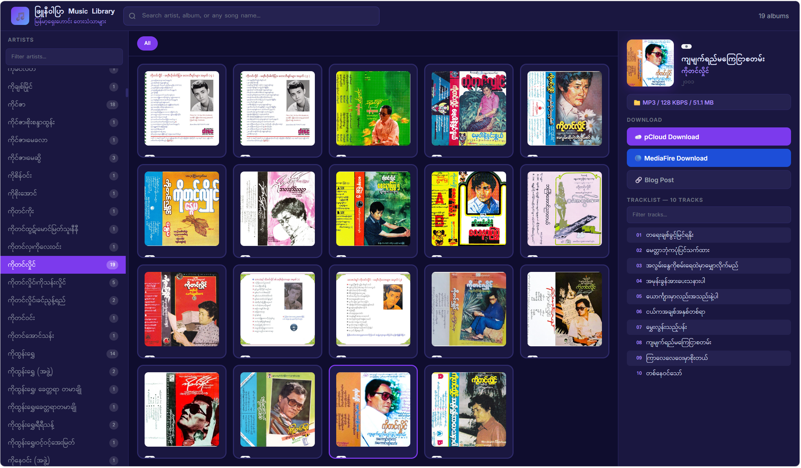
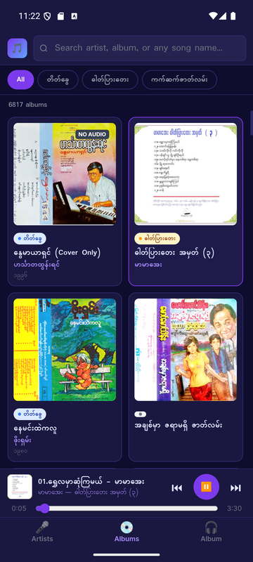
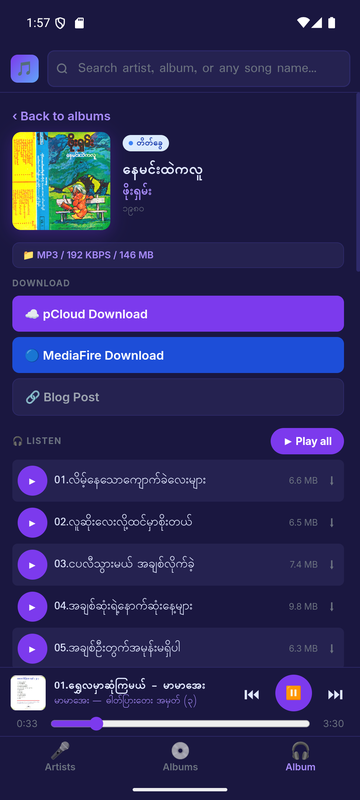
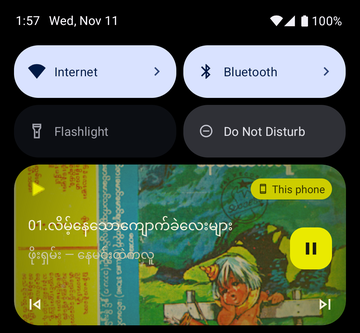

# ဖြူနီဝါပြာ Music Library

A browser for **6,800+ classical Burmese music albums** scraped from [phyuniwarpyar.blogspot.com](https://phyuniwarpyar.blogspot.com).

**[▶ Open Live Demo](https://admin-pss.github.io/myanmar-music-library/)** · **[📱 Download Android App (APK)](https://github.com/Admin-PSS/myanmar-music-library/releases/latest/download/myanmar-music-library.apk)**



## Features

- Browse albums by artist with album count
- Filter by format type (ဓါတ်ပြားတေး · တိတ်ခွေ · ကက်ဆက်ဇာတ်လမ်း)
- Search by artist name, album title, or any song in the tracklist
- Full tracklist with track-level search
- pCloud / MediaFire download links and blog post links
- Listen in the browser (MediaFire streaming player — play a track or the whole album)
- Mobile-friendly layout (one panel at a time with bottom tabs on phones)
- Android app with background playback

## 📱 Android app

<table>
  <tr>
    <td></td>
    <td></td>
    <td></td>
  </tr>
  <tr>
    <td align="center">Browse 6,800+ albums</td>
    <td align="center">Album page &amp; player</td>
    <td align="center">Controls with album cover</td>
  </tr>
</table>

**[⬇ Download the latest APK](https://github.com/Admin-PSS/myanmar-music-library/releases/latest/download/myanmar-music-library.apk)** · [All releases](https://github.com/Admin-PSS/myanmar-music-library/releases)

The app has everything the website has, plus:

- **Background playback** — music keeps playing with the screen off or while you use other apps
- **Notification & lock-screen controls** — play / pause / previous / next, with the album cover
- **Android Back button** moves between Artists → Albums → Album; on the main screen it sends the app to the background instead of closing it (so the music doesn't stop)
- The full album catalogue is built in — no waiting for it to download on start

**Requirements:** Android 6.0 or newer, and an internet connection (music and cover images stream from MediaFire / Blogger).

### Install

1. On your Android phone, open the [download link](https://github.com/Admin-PSS/myanmar-music-library/releases/latest/download/myanmar-music-library.apk) (or tap **📱** on the website).
2. Open the downloaded `myanmar-music-library.apk`.
3. If Android asks, allow **"Install unknown apps"** for your browser or file manager.
4. Google Play Protect may say the app is from an unknown developer — tap **More details → Install anyway**.

### Update

Download the new APK the same way and install it **over** the old one — no need to uninstall; your app is simply upgraded.

> On some phones (Xiaomi, Oppo, Vivo, Samsung…) battery saver may stop background music.
> If that happens, open **Settings → Apps → Myanmar Music Library → Battery** and choose **Unrestricted / No restrictions**.

### Versions

| Version | What's new |
|---|---|
| 1.2 | Album cover in the notification and on the lock screen |
| 1.1 | New app icon and splash screen |
| 1.0 | First release — mobile layout, streaming player, background playback |

The app is the same `index.html` UI wrapped with [Capacitor](https://capacitorjs.com), plus a small native playback service. The Android project source is kept in a separate private repository.

## Run locally

```bash
pip install -r requirements.txt
python app.py
# Opens http://localhost:5000 automatically
```

## Re-scrape the blog

```bash
# Full scrape (~6,800 posts, takes 30–60 min)
python scraper.py

# Resume after interruption
python scraper.py --resume

# Or use the GUI
python scraper_ui.py
```

Scraper output: `albums.json` + `albums.xlsx`

## Project structure

```
├── scraper.py          # Blogger Atom feed scraper
├── scraper_ui.py       # Tkinter GUI for the scraper
├── app.py              # Flask dev server
├── index.html          # The UI — used by GitHub Pages and the Android app
├── templates/
│   └── index.html      # Flask template — generated from index.html, don't edit by hand
├── sync_template.py    # Regenerates templates/index.html after UI changes
├── albums.json         # Scraped album data (6,800+ albums)
├── docs/               # README screenshots
└── requirements.txt
```

After changing `index.html`, run `python sync_template.py` so the Flask version stays the same.

## Data source

All album data is scraped from [phyuniwarpyar.blogspot.com](https://phyuniwarpyar.blogspot.com) — a blog dedicated to preserving classical Burmese music. Downloads link to pCloud and MediaFire as hosted by the blog author.
